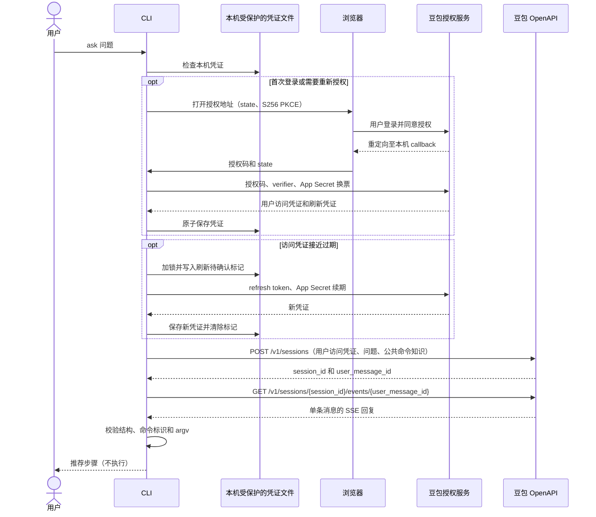

# CLI 直连豆包：构建与使用指南

登录换票、刷新凭证和问答请求均由 CLI 直接访问豆包，运行时不依赖 `ask-auth`、TCE、TCC、MySQL 或 TLB。原 `ask-auth` 服务端代码、测试、迁移和部署脚本已从仓库移除；已创建的云端资源未做删除操作。

发行方在本地或 SCM 编译时注入自己的 App ID 和 App Secret，`ask` 所需的权限集合固定在 CLI 中。客户安装带有应用配置的官方预编译包后，只需登录授权，无需创建应用、配置 App Secret 或部署服务端。

当前使用虚构凭证和本地模拟接口验证实现，尚未完成真实测试应用联调。权限、回调地址、内部和外部账号覆盖、额度归属，以及豆包内置 Agent 的工具边界均需实测确认。编译注入使 Secret 随二进制分发，不保证它无法被提取；真实密钥不得写入源码、Git、示例或构建日志。

## 1. 客户使用

安装包含本功能且已注入应用配置的官方预编译包后，使用：

```sh
ve-adrive-cli ask auth login
ve-adrive-cli ask '往 ADrive 上传本地文件应该执行什么命令？'
```

`ve-tos-cli`、`tos-cli` 使用相同的 `ask auth` 和 `ask` 入口。客户运行时不需要设置下节的构建环境变量，也不需要创建应用密钥文件。完整登录、续期和问答流程见第 3 节。

`cargo install` 在客户机器上重新编译源码，不会继承发行方本地或 SCM 的私有环境变量；未注入配置的源码构建仍可使用存储命令，`ask` 会提示使用带应用配置的官方预编译包。源码构建方拥有自己的应用时，也可以自行按第 2 节注入配置。

豆包与 ADrive 共用 `credentials.toml`、已有的 `.key` 和跨平台加密写入能力，通过独立命名空间区分授权。豆包跟随 `--profile` 保存和切换登录，刷新锁和不确定结果标记按凭据文件与 profile 隔离。Unix 设置文件权限，Windows 沿用已有权限继承方式。Windows 和 Linux 仍需原生环境回归；本地测试不等于真实平台登录已通过验收。

## 2. 发行方构建与内部联调

### 2.1 准备应用

1. 在豆包开放平台开通应用所需的用户权限，并确认目标用户可以授权。
2. 配置完整回调地址 `http://localhost:8080/callback`。CLI 会临时监听本机回环地址，接收授权码；该地址是否被具体测试应用接受，需要真实联调确认。
3. 在应用后台开通以下三项用户权限。CLI 登录时固定申请这个集合，构建时无需配置 scope；后台开通与用户授权都必须满足。

   | 固定权限 | 用途与依据 |
   | --- | --- |
   | `doubao:session:write` | [创建会话并提交首条问题](https://open.doubao.com/document/uAjLw4CM/ukTMukTMukTM/doubao/agent-v1/session/create)。 |
   | `doubao:session.event:read` | [读取单请求回复流](https://open.doubao.com/document/uAjLw4CM/ukTMukTMukTM/doubao/agent-v1/session-event/stream)。 |
   | `offline_access` | [获取刷新凭证以自动续期](https://open.doubao.com/document/store-app-development/development-configuration/authenticate-and-authorize/get-user_access_token)。 |

4. 把 App Secret 配置到本地受控构建环境或 SCM 的密钥变量中。不要发送到聊天，不要写进脚本，不要在启用 shell 跟踪或环境转储的任务中构建。

### 2.2 编译时注入

固定使用以下两个环境变量，必须同时提供：

| 构建环境变量 | 含义 |
| --- | --- |
| `STORAGE_CLI_BUILD_DOUBAO_APP_ID` | 发行方的 App ID。 |
| `STORAGE_CLI_BUILD_DOUBAO_APP_SECRET` | 发行方的 App Secret，由受控环境提供。 |

变量名固定，值不固定。应用凭据轮换后，需要重新构建并分发新二进制；修改客户运行时环境不会改写已经编译的应用配置。

本地 Bash 的隐藏输入示例，以及 SCM 中普通变量和密钥变量的配置方式，见[发布手册的二进制归档构建步骤](../packaging/README.md#1-build-binary-archives)。App ID 与 App Secret 必须属于同一个应用，每个目标平台的构建任务都需要完整注入这两个变量。旧的 `STORAGE_CLI_BUILD_DOUBAO_SCOPES` 不再读取，可以从构建环境中删除。

本地和 SCM 均先注入上述变量，再运行相同构建命令：

```sh
cargo build --locked --release
```

Cargo 子进程会自动继承已导出的环境变量，Rust 的 `option_env!` 在编译时读取它们，无需额外转发 Secret。仅设置 Shell 变量而没有 `export`，或只写入 `.env` 文件，不会自动进入 Cargo。构建会显示不含凭据值的提示：`Doubao ask application: bundled` 表示收到完整配置，`not bundled` 表示两个变量均未收到；部分配置会使构建失败。构建脚本也会跟踪变量变化，无需先执行 `cargo clean`。

在 `.bash_profile` 等文件中赋值，或通过 `echo` 看到值，都不能证明变量已经导出。已有值时，只需在编译前执行 `export STORAGE_CLI_BUILD_DOUBAO_APP_ID STORAGE_CLI_BUILD_DOUBAO_APP_SECRET`，无需重新输入或输出凭据。

调试构建执行 `cargo build` 后，应检查本次生成的 debug 产物：

```sh
./target/debug/ve-storage-uni-cli ve-adrive ask --describe --output json
```

其中 `application_bundled` 应为 `true`。`cargo build --release` 对应 `target/release`；使用自定义目标目录或 `--target` 时，也应运行对应位置的新产物。不要把不同构建的二进制混用。未提供应用变量时运行 Cargo 构建或测试，可能重新生成无应用配置的产物。

发行打包时显式要求应用配置：

```sh
python3 packaging/scripts/release.py archives --help
# 选择实际目标平台后执行，例如在 macOS arm64 构建机：
python3 packaging/scripts/release.py archives \
  --target aarch64-apple-darwin --require-ask-credentials
```

`archives` 和 `all` 均支持 `--require-ask-credentials`。该选项会在构建前校验应用配置完整性，并拒绝与 `--skip-build` 同用，避免把未经注入的旧二进制打包。本机可运行的目标会检查各个选中产品的 `ask --describe` 中 `application_bundled` 是否为 `true`；交叉编译目标需要在对应平台补做运行验收。此标记仅表示已编入应用配置，不代表权限、网络、用户登录或平台支持已通过验收。

完全不提供这两个变量时，普通开发构建继续可用；只提供一部分、空值或格式错误时，构建会失败，诊断不输出变量值。编译器通过 `option_env!` 读取配置，不生成含密钥的源码文件，不将 Secret 放入命令参数或 Cargo 的 `rustc-env` 输出。

npm、pip、Homebrew 和安装脚本复用的必须是本次构建产出的配置完整的二进制。构建目录、编译缓存和发行二进制都可能包含 Secret，应按发行方凭据处理，不能把编译注入描述为加密保密。

### 2.3 内部测试应用覆盖

内部开发人员可以继续使用独立测试应用和受保护的 Secret 文件。此入口不要求普通客户配置：

```sh
export STORAGE_CLI_DOUBAO_APP_ID='<测试应用 App ID>'
export STORAGE_CLI_DOUBAO_SCOPES='<平台确认的用户权限标识，用空格分隔>'
export STORAGE_CLI_DOUBAO_APP_SECRET_FILE='/绝对路径/受保护的测试密钥文件'
```

文件内容由本地受控方式填写，必须是普通文件，不接受符号链接。Unix 上要求文件属于当前用户，权限为 `0600` 或 `0400`，禁止硬链接；Windows 沿用已有凭据文件的权限继承方式，应放在当前用户的私有目录中。

只要上述任一运行时变量存在，就进入完整的内部覆盖模式，必须提供该测试应用自己的 App ID 和权限集合。它不会使用内置 App Secret，也不会在测试密钥文件无效时回退到内置凭据。仅查询状态或退出登录时可以不提供密钥文件；登录和续期时需要该文件。恢复官方应用时，应清除全部三个运行时应用变量。

以下设置独立于应用覆盖，单独设置它们不会禁用内置应用：

| 环境变量 | 默认值 | 含义 |
| --- | --- | --- |
| `STORAGE_CLI_DOUBAO_CALLBACK` | `http://localhost:8080/callback` | 必须与应用注册值一致，只接受带端口的本机 HTTP 回环地址和 `/callback` 路径。 |
| `STORAGE_CLI_ASK_HOME` | `~/.tos/ask` | 旧版豆包凭据的迁移来源；不改变新凭据、主密钥或共享刷新协调状态的位置。 |

Unix 上豆包协调目录采用 `0700`，凭据和锁文件采用 `0600`；Windows 沿用已有权限继承方式。用户 Token 用现有公共主密钥加密，不再生成新的豆包密钥。该机制不能防御已经控制同一系统账号的攻击者。

## 3. 登录和提问

两套登录凭据在同一文件中使用独立命名空间。默认组织如下：

| 文件 | 内容与用途 |
| --- | --- |
| `~/.tos/credentials.toml` | ADrive 使用 `[<profile>.adrive.oauth]`，豆包使用 `[<profile>.doubao.oauth]`。两者的 `access_token` 和 `refresh_token` 分别是 `ENC:` 密文，过期时间及授权元数据保存在各自分组。 |
| `~/.tos/.key` | 已有公共主密钥，首次保存凭据时按需初始化；新增豆包授权不替换现有密钥。自定义凭据文件时使用其同目录 `.key`。 |
| `~/.tos/.credentials.lock` | 目录级公共事务锁，覆盖同目录凭据的读取、修改和原子保存；HTTP 请求不持有该锁。 |
| `~/.tos/.key.lock` | 主密钥首次初始化的协调锁，保护包括旧配置写入在内的所有初始化入口；不是额外密钥。 |
| `~/.tos/ask/.lock-<hash>`、`pending-<hash>` | 豆包刷新互斥及结果不确定标记；哈希由凭据文件路径和 profile 派生，互不影响。 |

`ask auth logout` 只清除选中 profile 的豆包 OAuth 字段和对应 `pending`；`default` 保留非敏感的旧数据导入禁用标记。ADrive 的 `auth logout` 只清除该 profile 的 ADrive OAuth 分组。两者均保留公共密钥、其他服务和其他 profile 的凭据。用户 Token 与编译注入的 App Secret 分别管理。

旧版 `~/.tos/ask/tokens` 支持二进制和 `ENC:` 格式。迁移时取得原有 `.lock`，仅导入 `default`，因为旧登录不属于特定 profile。旧 `pending` 若表示刷新结果不确定，保持原文件不变并要求重新登录，不迁移该凭据。正常接管仅在旧 `pending` 缺失时写入标记，阻止旧客户端或其他目标文件复用同一个 Refresh Token；接管失败后重新登录，不重复自动导入。新的登录数据与 `legacy_import_disabled` 标记在同一事务中提交，退出后不会再次导回。旧 Token 文件和 `.key` 保留，不自动删除，以免误删自定义目录中其他存储的数据；新版本不生成豆包专用密钥。旧版本 CLI 若不识别新命名空间，可能拒绝读取该文件，应使用支持本格式的版本。

新刷新协调目录固定在选定凭据文件的同目录 `ask/` 下，不跟随旧目录覆盖值变化；相同凭据文件和 profile 始终使用同一把刷新锁和不确定标记。

三种独立 CLI 使用相同入口。以 ADrive 为例：

```sh
ve-adrive-cli ask auth login
ve-adrive-cli ask auth status
ve-adrive-cli ask '往 ADrive 上传本地文件应该执行什么命令？'
ve-adrive-cli ask auth logout
```

切换 profile 时登录与提问使用同一个名称，例如 `ve-adrive-cli ask auth login --profile work` 和 `ve-adrive-cli ask '如何上传文件？' --profile work`。不同产品的 `ask` 共用同一凭据文件、同一 profile 下的豆包授权。

`ve-tos-cli` 和 `tos-cli` 同样支持上述入口。统一 CLI 在产品名后调用，例如 `ve-storage-uni-cli ve-adrive ask '如何上传文件？'`。ADrive 原有的 `auth login/status/logout` 继续管理 ADrive 凭证；豆包助手的授权管理统一放在 `ask auth` 下。

`ask` 使用独立的豆包 OAuth。`--profile` 选择登录，`--credentials-path` 选择公共凭据文件，`--config-path` 参与定位默认凭据文件的父目录，不向模型发送存储配置。`--auth-mode`、`--region`、`--endpoint`、服务发现和删除确认参数仍不参与问答，因此不会出现在帮助中。输出、筛选、详细信息、禁止自动登录、说明和预演分别通过 `--output`、`--query`、`--verbose`、`--quiet`、`--describe` 和 `--dry-run` 控制。

只有 `auth` 是 `ask` 的管理子命令；`login`、`status`、`logout` 可以直接作为问题。提问单词 `auth` 时使用显式参数：

```sh
ve-adrive-cli ask --question 'auth'
```

位置问题、`--question` 和 `ask auth` 管理操作不能同时使用。



显式登录会绑定本机监听端口，然后打开浏览器。CLI 使用随机 `state` 和 S256 PKCE，验证回调后自行换票并保存凭证。无浏览器环境可使用 `ask auth login --no-browser`，按提示在浏览器打开授权链接。链接和回调内容不要转发给其他人。

Windows 自动打开系统默认浏览器；macOS 使用系统 `open`，Linux 使用 `xdg-open`。Windows 通过系统 Shell API 打开完整授权 URL，不经过命令解释器。启动失败或超时会提示使用 `ask auth login --no-browser` 手动打开链接；该选项是主动选择或失败恢复方式，不是 Windows 的必选项。

浏览器必须能访问 CLI 所在机器的回环监听端口。若 CLI 运行在 SSH 远端，而浏览器在本机，需要先建立对应端口的 SSH 转发；仅复制链接到另一台电脑不能完成回调。`--no-browser` 只是不自动打开浏览器，不会改变回调地址。

有交互终端时，首次 `ask` 可以触发同一登录流程。非交互调用若缺少有效凭证，会返回需要登录，不会等待浏览器授权。裸 `ask` 显示用法，不进入交互循环。

`ask` 和 `ask auth` 的业务错误统一以 JSON 写入 stderr，并返回非零退出码；`--output`、`--query` 和 `--quiet` 不会隐藏错误信息。成功结果仍按所选格式写入 stdout。应用配置缺失时返回 `doubao_configuration`（退出码 `3`），需要发行方注入配置后重新编译；配置完整但非交互调用尚未登录时返回 `doubao_login_required`（退出码 `2`），并附上对应的 `ask auth login --no-browser` 命令。

裸 `ask auth` 显示授权管理用法，不读取配置、不登录、不提问。它与具体授权动作的 `--describe` / `--dry-run` 都只展示说明或预演。

本批每次提问创建一个新会话，不需要用户填写会话 ID。CLI 发送用户问题和根据当前产品命令定义生成的公共知识，不自动读取本地业务文件或账号配置。返回的步骤和参数仅供用户审阅，CLI 不执行推荐命令。

## 4. 续期和恢复

访问凭证接近过期时，CLI 持有对应凭据文件及 profile 的豆包刷新锁，直接向豆包刷新，再通过公共凭据事务保存新凭证。它会先持久化“刷新已开始”标记。如果请求超时、进程退出或保存失败，不能确认旧 refresh token 是否已消费，下一次要求重新登录。公共事务锁仅用于短暂的读改写，不覆盖 HTTP 请求；TOS 配置写入、ADrive 登录/刷新和豆包更新均通过此入口保留其他命名空间的最新内容。

`ask auth status` 只检查本机状态，不代表平台仍接受令牌。`ask auth logout` 清除本机登录状态，不等同于在平台撤销授权。状态查询和退出无需提供 App Secret 文件，不会发起换票或刷新请求。

本机状态与 App ID、完整回调地址和权限集合绑定。更换这些配置后需要重新登录；不要手动修改令牌文件。

端口被占用时，关闭占用进程，或先在应用注册另一个允许的回调地址，再同步设置 `STORAGE_CLI_DOUBAO_CALLBACK`。不能仅修改 CLI 而保留不同的平台注册值。

## 5. 问答边界

模型返回的命令标识和参数必须通过本版 CLI 的命令定义和解析器验证，未知命令、无效参数、异常协议或危险终端控制字符均不会成为成功建议。语法验证不能保证业务语义、资源名称或权限正确，执行前仍需用户审阅。

系统提示要求围绕本工具回答，并支持返回范围外、澄清或解释结果。提示词不是额度或安全隔离机制，无法保证完全阻止无关问题。

当前 OpenAPI 使用豆包内置 Agent。文档没有提供关闭其云端工具的请求参数；本客户端拒绝观察到的工具或附件事件，但这不能阻止云端此前已经进行的动作。正式启用前需要向平台确认可用工具和数据范围。

## 6. 验证与验收

本地测试只使用虚构凭证和回环 HTTP 服务，生产端点不能通过环境变量替换。重点覆盖：

1. 正常登录、回调验证和独立凭证保存。
2. 错误 `state`、重复参数、拒绝授权和回调超时。
3. 刷新轮换、并发进程、刷新结果不确定时重新登录。
4. 文件权限、符号链接、特殊文件和异常凭证内容。
5. 分块 SSE、UTF-8、重复文本、匹配的完成事件及不完整回复。
6. 推荐命令解析、未知参数、终端控制字符和无关问题。
7. 三种产品入口和既有 ADrive 登录流程的回归。
8. `ask auth` 管理操作、`--question 'auth'` 和普通问题词的解析及互斥校验。

真实平台验收还需要：开通权限的测试应用、回调白名单、实际用户授权、换票与刷新、一次问答、不同账号覆盖，以及退出后重新授权。真实平台验收尚未完成，不将本地模拟结果表述为上线验证。

协议来源：[豆包 OpenAPI 文档](https://bytedance.larkoffice.com/wiki/AgniwHYJnimvGPk09GLcpfCFnMg)，本次读取日期为 2026-11-22。问答使用创建会话和单条消息的 `MessageStream`；文档中的全会话事件流标为暂缓。
